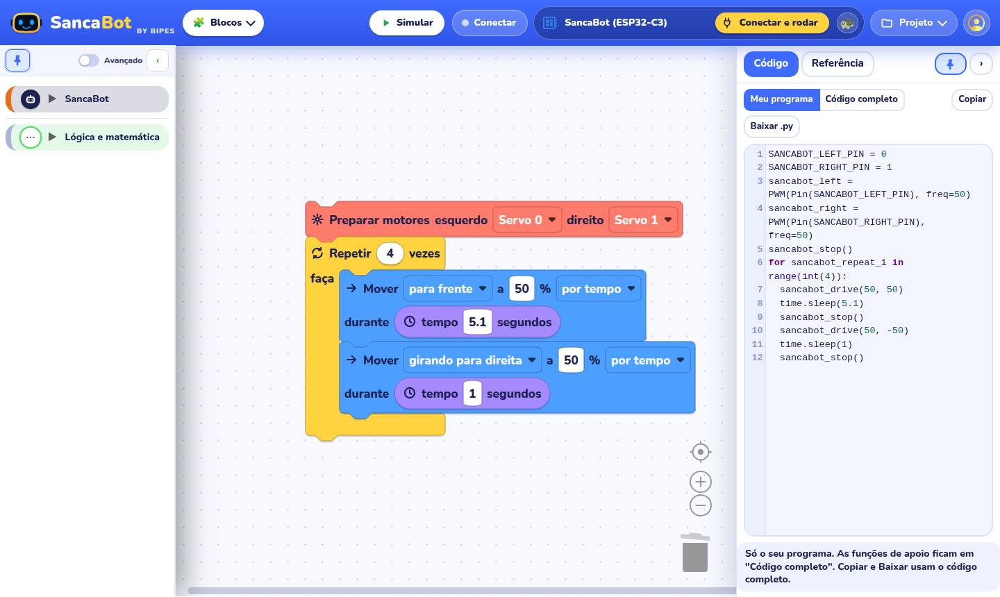
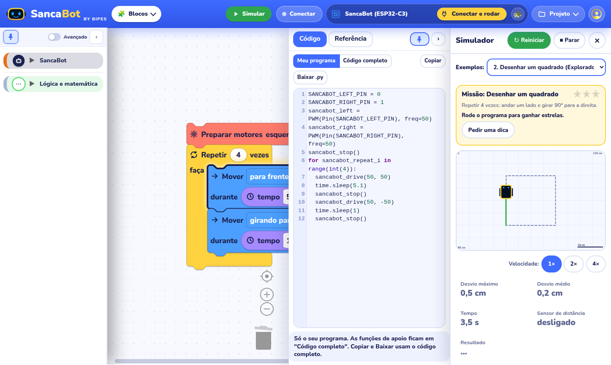
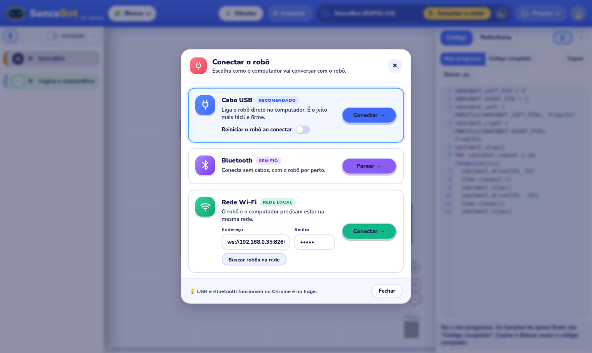
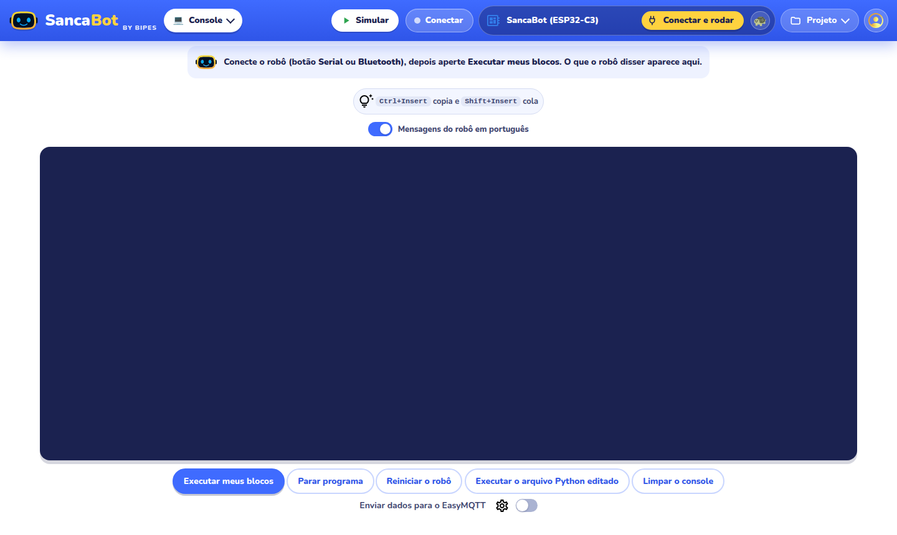
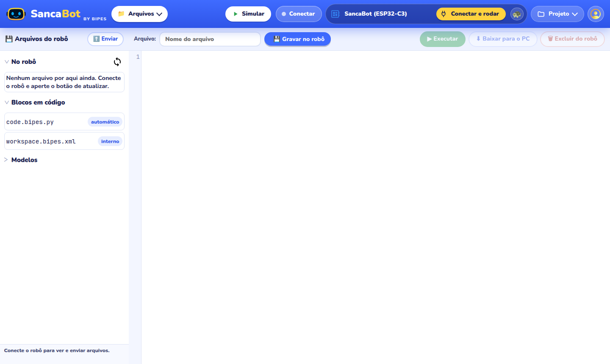
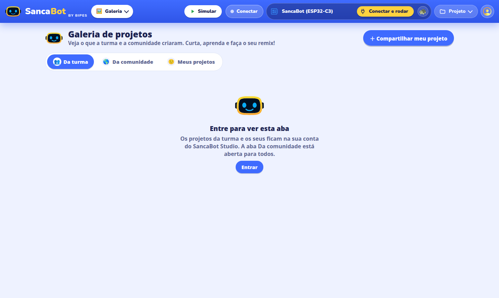
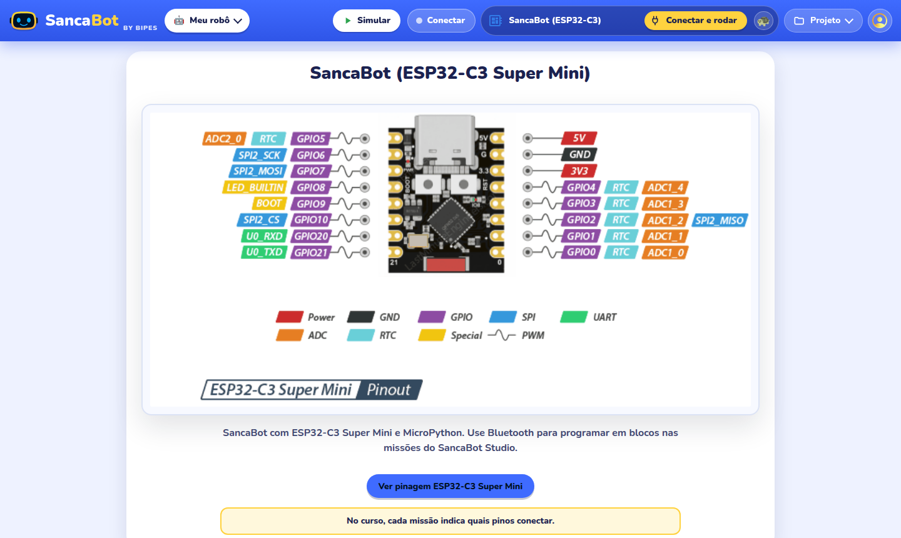
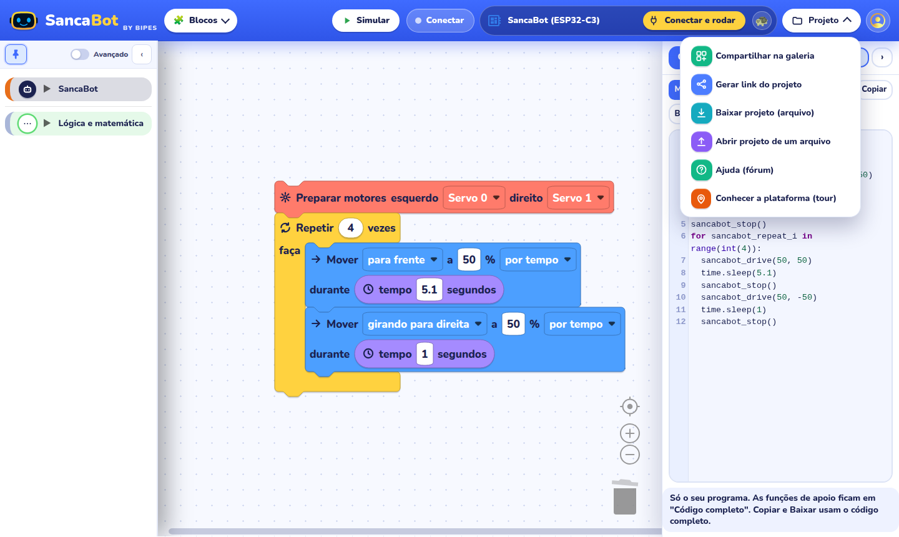
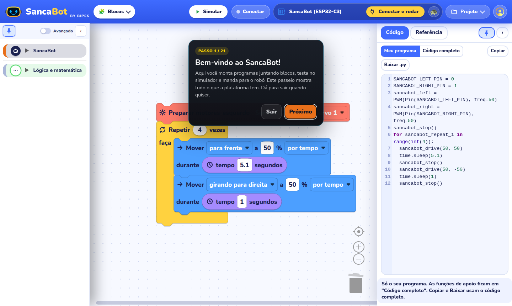

# SancaBot by BIPES

Editor de programação em blocos para o robô SancaBot, uma plataforma educacional para alunos do ciclo básico. O aluno monta o programa, testa num robô simulado e, quando quiser, manda para o robô de verdade. Tudo roda no navegador, sem instalar nada.

É uma versão do [BIPES](https://github.com/BIPES/BIPES) adaptada ao SancaBot: placa ESP32-C3 Super Mini com MicroPython, blocos em português e uma interface pensada para estudantes.



## Um passeio pelo editor

O editor tem um tour dentro dele (menu Projeto, item "Conhecer a plataforma"). Este é o mesmo caminho, com figuras.

### Blocos

A tela inicial é a área de montagem. A caixa da esquerda guarda os blocos por assunto. A categoria SancaBot, em laranja, tem tudo o que o robô sabe fazer: preparar os motores, mover, girar, medir distância e parar. Para começar aparecem só as categorias mais simples. A chave "Avançado" mostra as demais.

Os blocos se encaixam de cima para baixo, e o robô obedece nessa ordem. Os nomes dos pinos são os do robô: Servo 0 e 1 para os motores, IR 5 e 6 para os sensores de linha, Ultrassom 7 e 8 para o sensor de distância.

### Código e referência

O painel da direita mostra o programa em Python que os blocos geram. Dá para copiar e para baixar como arquivo `.py`. Na aba Referência fica a ajuda de cada bloco, com busca. Quem quiser mais espaço pode recolher o painel ou fixá-lo.

### Simulador

Sem robô por perto, o botão Simular abre um tablado virtual de 120 por 80 cm. A lista de exemplos traz 8 programas prontos, do "andar em linha reta" ao "parar antes da parede". Dá para escolher a trajetória que o robô deve seguir (reta, quadrado, oito, curva em S ou uma desenhada à mão), colocar parede, caixa e cone, e ver o desvio máximo, o desvio médio, o tempo e a leitura do sensor de distância. A velocidade vai de 1× a 4×. Cada exemplo vale até três estrelas, e o botão "Pedir uma dica" ajuda quem travou.



Atenção: o simulador usa medidas provisórias do robô (10 cm entre as rodas e 1 s para girar 90°). Elas ainda precisam ser trocadas pelas medidas reais. O roteiro está em [docs/projeto/MEDIDAS-DO-ROBO.md](docs/projeto/MEDIDAS-DO-ROBO.md).

### Conectar o robô

O botão Conectar oferece três caminhos. O cabo USB é o mais fácil. O Bluetooth dispensa o cabo, e o Wi-Fi serve quando o robô e o computador estão na mesma rede. USB e Bluetooth só funcionam no Chrome e no Edge. Com a conexão feita, o botão "Conectar e rodar" envia o programa, e cada bloco acende na hora em que o robô o executa.



Ao lado do botão há uma tartaruga. Ela liga o modo passo a passo, que faz uma pausa depois de cada bloco. É útil para entender o que o programa faz e para achar onde ele errou.

### Console

O Console é a conversa com o robô. O que ele escreve aparece ali, e o aluno também pode digitar comandos. Os erros do MicroPython chegam traduzidos para o português, e uma chave desliga a tradução para quem quiser ver o texto original. Abaixo do terminal ficam os botões para executar os blocos, parar o programa, reiniciar o robô, executar um arquivo Python e limpar a tela.



### Arquivos

Mostra os arquivos que estão dentro do robô. Dá para abrir, editar, gravar, executar, baixar para o computador e apagar. A mesma tela envia um arquivo do computador para o robô e guarda o `code.bipes.py`, que é o programa gerado pelos blocos.



### Galeria

Os projetos da turma e da comunidade aparecem aqui. O aluno abre um projeto, faz o seu remix e compartilha o que criou. A galeria da turma pede login no [SancaBot Studio](https://github.com/mese-br/sancabot-studio), e a da comunidade é aberta a todos. Cada projeto compartilhado ganha um link que abre uma cópia no editor de quem clicar.



### Meu robô

O esquema da placa ESP32-C3 Super Mini, com o nome de cada pino, e o link para a documentação. Serve de consulta na hora de ligar sensores e motores.



### Menu Projeto e perfil

O menu Projeto reúne o que se faz com o programa pronto: compartilhar na galeria, gerar o link, baixar como arquivo, abrir um arquivo guardado, pedir ajuda no fórum e rever o tour. O ícone de perfil, no canto, lista os projetos guardados neste computador. Cada um pode ser renomeado, baixado ou apagado.





## Rodar na sua máquina

O editor é estático. Qualquer servidor web serve, desde que o endereço seja `localhost` ou HTTPS, porque o navegador só libera a porta USB nessas condições.

```
cd ui-v4
python3 -m http.server 8090
```

Depois abra `http://localhost:8090/`. Para testar sem o robô, acrescente `?robo=simulado` ao endereço: ele troca a porta USB por um robô de mentira que responde como o MicroPython. A abertura direta de um projeto da galeria usa `?galeria=ID`, e o tour abre com `?tour=1`.

## Versões

Há duas interfaces nesta pasta.

- `ui/` é a v3, a que está em produção.
- `ui-v4/` é a v4, uma interface nova, com CSS próprio, sem rastreadores de terceiros e com o simulador, a galeria e o tour. Ainda está em desenvolvimento e passa por todos os testes automáticos, mas falta provar com o robô de verdade antes de ela substituir a v3.

O caminho para promover a v4, e para voltar atrás se for preciso, está em [docs/projeto/PROMOCAO-V4.md](docs/projeto/PROMOCAO-V4.md). Antes de testar com o robô, siga o [roteiro de bancada](docs/projeto/ROTEIRO-DE-BANCADA.md), que leva uns 45 minutos e inclui as medidas que faltam.

## Documentação

- [docs/projeto/](docs/projeto/README.md): estado, roadmap, arquitetura, decisões, qualidade e riscos.
- [docs/simulador.md](docs/simulador.md) e [docs/simulador-exemplos.md](docs/simulador-exemplos.md): como o simulador funciona e os 8 exemplos.
- [README-SANCABOT.md](README-SANCABOT.md): convenções para criar novos blocos.
- [CHANGELOG.md](CHANGELOG.md): o que mudou em cada versão.

Os testes automáticos e o servidor de desenvolvimento ficam em outro repositório, o `dev-local`.

## Créditos e licença

O SancaBot by BIPES parte do [BIPES](https://bipes.net.br/) e segue a mesma licença, a GPL-3.0. Algumas funções do editor vieram do projeto [Blopy](https://github.com/mnoriaki/Blopy), de Noriaki Mitsunaga. O terminal usa o [xterm.js](https://github.com/xtermjs/xterm.js) e o editor de arquivos usa o [CodeMirror](https://github.com/codemirror/codemirror). Os blocos rodam sobre o [Blockly](https://developers.google.com/blockly).

A documentação do BIPES original continua em [bipes.net.br/docs](https://bipes.net.br/docs).
